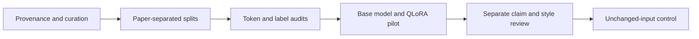

# Meaning-preserving economics rewriting with Gemma and QLoRA

An experimental fine-tuning project: rewrite neutral plain English into the economics prose of Eugene Fama and his coauthors **while preserving the original claims**. This repository contains data-curation tools, training/evaluation code, standalone Kaggle notebooks, CPU tests, and an offline review interface.

**Current finding:** QLoRA reduced validation loss but increased copying. Explicit rhetorical and claim guidance can improve individual controls, but faithful Fama/coauthor-style transformation is **not established**. The project reports these negative and mixed results separately from successful pipeline execution.

**Agreed development direction:** Fama/coauthor rewriting remains the main
target. The first operational milestone is multi-author academic rewriting,
measuring reduced detectability, meaning, readability and copying separately.
Author provenance is retained for future author-conditioned comparisons.
[Development plan](docs/DEVELOPMENT_PLAN.md) ·
[Prepared milestone protocol](docs/multi_author_v1/PROTOCOL.md).

**Current preparation:** [seventeen actual-error preference candidates](docs/actual_error_preferences_v1/README.md)
are curated from saved training-side adapter outputs, with two uncertain cases
held and five nonmaterial cases excluded. The packet includes a matched chosen-only
SFT control. Most chosen references overlap more with the inputs, and often are
longer, so preference training is not yet justified as a copying or style remedy.
The [real token/mask preflight now passes](docs/preference_preflight_v1/RUN_V2_RECOVERY.md)
on all seventeen pairs and 34 sequences, with exact archived chosen-token hashes.
Kaggle version 2 exported its tokenizer before a structured-return code bug; the
bug was fixed and the full check completed locally without weights or GPU use.
No further Kaggle replay is needed. The [bounded pilot implementation](docs/actual_error_preferences_v1/PILOT_IMPLEMENTATION.md)
now prepares independent 22-update SFT and DPO arms with eight frozen development
cases. The [completed pilot](docs/actual_error_preferences_v1/PILOT_RESULTS_V1.md)
passed all execution checks in 20.3 minutes, but neither arm improved the material
claim-issue count (4/8) or locally eligible count (3/8). Six SFT and five DPO outputs
exactly match the unchanged adapter; lower target loss did not establish better
generation. Neither checkpoint qualifies for detector scans. No further training
has been started.

The [completed training-side diagnostic](docs/actual_error_preferences_v1/TRAINING_SIDE_RESULTS_V1.md)
also finds no material-error corrections on eleven selected seen inputs. Each
final adapter exactly repeats eight controls; the targeted errors persist in all
eleven cases. All 22 inference calls completed in 5.6 minutes, with zero updates.
This points to limited behavioral change before any question of held-out transfer.
The [completed stronger SFT check](docs/actual_error_preferences_v1/SFT_STRENGTH_RESULTS_V1.md)
at `1e-5` changes all nineteen outputs and resolves material errors in two selected
training cases. Development target loss falls to 1.517, but material issues remain
4/8 and local eligibility falls from 3/8 to 2/8 after a new exclusive-purpose error.
Generic expression improves in several cases; the quality gate still fails.
The [matched stronger-DPO result](docs/actual_error_preferences_v1/DPO_STRENGTH_RESULTS_V1.md)
adds no demonstrated benefit over stronger SFT: thirteen of nineteen outputs are
identical, with the same material-error and meaning-budget counts. The low final
DPO loss (0.0345) does not translate into better claim preservation. Pause further
sweeps and detector scans; a training-only minimal-repair preference audit is
proposed to isolate semantic corrections from full-reference style differences.
No new GPU job has started.

This addresses the rewriting behavior identified by the
[completed detector comparison](docs/milestone_checkpoint_4b_v1/DETECTOR_RESULTS_V2.md).
Twenty texts have now been scanned with each provider. Both flag all twelve
Gemma outputs as AI-related and label all four human references human; Pangram
misses all four GPT-6 inputs, while GPTZero misses two. Pangram is a practical
lower-cost instrument for future Gemma checks, with equivalent overall accuracy
still unproven. No additional scans or training are initiated. This follows the
[reviewed 4B milestone checkpoint](docs/milestone_checkpoint_4b_v1/RESULTS.md).
All fourteen missing outputs completed. On eight frozen cases, provisional
automated review finds material issues in 7–8 ordinary-base outputs, five with
source-only structural guidance and four with the existing adapter. Both
alternatives meet the local meaning budget in only three cases. Generic
exposition looks better, but detector gains and distinctive Fama style remain
unestablished. The bounded preference pilot is complete; full training remains
outside its scope.

[Author inventory and nine new paper acquisitions](docs/author_inventory_v1/README.md)
· [Direct rewriting versus neutral reconstruction design](docs/author_inventory_v1/NEUTRAL_RECONSTRUCTION.md).

The [v2 inventory](docs/author_inventory_v2/README.md) expands the selected roster
to 13 papers each for Fama/coauthors, Shiller, Holmström/coauthors and
Baker–Wurgler/coauthors. [Source curation](docs/author_curation_v1/README.md) now
provides 1,042 paragraph candidates from the 39 non-Fama papers; paired annotation
and semantic verification are pending.

The [source-generation pilot](docs/neutral_reconstruction_v1/STAGE2_RESULTS.md)
now has 16 reviewed outputs: neutral reconstruction copies less and changes
organization more. A [three-case instruction repair](docs/neutral_reconstruction_v1/INSTRUCTION_CHECK_RESULTS.md)
removed the observed added commentary; a subsequent [versioned binding audit](docs/neutral_reconstruction_v1/SEMANTIC_BINDING_REPAIR.md)
corrected two remaining scope issues in one brief. A subsequent
[Gemma 4B inference check](docs/neutral_reconstruction_v1/GEMMA4B_V1_RESULTS.md)
completed six outputs before a formatting-check failure. Offline recovery found
material claim issues in all three brief-only reconstructions; the current
detailed-brief format is not ready for training-data construction. GPT-6 findings
remain separate from these student-model results.
A [local quantized 1B diagnostic](docs/neutral_reconstruction_v1/LOCAL_1B_RESULTS.md)
then completed nine prose-only outputs: compact claims used fewer tokens but
did not eliminate claim errors. This checks a local prompt workflow, not 4B
performance or a post-training gain.
The [matched prose-only 4B study](docs/neutral_reconstruction_v1/GEMMA4B_PROSE_RESULTS.md)
completed nine outputs with no format failures, but compact claims showed no
reliable fidelity benefit. This neutral-data-writing task is separate from the
reverse-direction text-pair fine-tuning objective; it is not a prerequisite for SFT.
A [small reverse-direction teacher-pair pilot](docs/teacher_pair_pilot_v1/README.md)
is prepared with 16 provisionally aligned training pairs and eight development
pairs from separate papers and authors. The base notebook is the first execution
step. After its review, the user authorized the
[two-epoch/16-update pilot](docs/teacher_pair_pilot_v1/PILOT_RUN.md), subsequently
executed on Kaggle.
The [version 1 baseline](docs/teacher_pair_pilot_v1/BASELINE_RESULTS.md) has now
completed: target-token-weighted loss 2.96942 and zero exact source copies, but
seven of eight development outputs have material claim issues in automated review.
The [pilot results](docs/teacher_pair_pilot_v1/PILOT_RESULTS.md) show an 11.9%
loss reduction, zero exact copies, and modest concision/organization preferences
in five of eight final outputs. Material claim issues persist in six of eight;
Fama-specific style and detector improvements remain unestablished.
The [v2 curation audit](docs/teacher_pair_pilot_v2/README.md) now expands training
from 16 to 46 provisionally aligned pairs while retaining the exact eight
development rows. Twelve candidates remain held. This is a data-only release;
no new training run or budget is authorized.
The separate [expanded follow-up](docs/teacher_pair_pilot_v2/EXPERIMENT.md) is now
prepared: baseline first, followed by a two-epoch/46-update pilot. No GPU job was
submitted by the preparation tools.
The [expanded baseline](docs/teacher_pair_pilot_v2/BASELINE_RESULTS.md) has now
passed all 54 token/label checks and exactly reproduced the earlier ten outputs
and eight losses. Claim issues persist in seven of eight development outputs;
the user subsequently authorized the
[46-update pilot for manual execution](docs/teacher_pair_pilot_v2/PILOT_RUN.md).
Its enabled notebook pins the exact reviewed baseline and data hashes; no job
has been submitted by these tools.
The [expanded pilot results](docs/teacher_pair_pilot_v2/PILOT_RESULTS.md) are now
available: all 46 updates and adapter reload pass, with a 36.15% loss reduction
and six generic expression wins versus base. Material claim issues persist in
six of eight development cases, so the predeclared improvement gate fails.
Both training probes recover their main information relationships, but no
Fama-specific style or detector gain is established. No further run is authorized.
The [training-only coverage audit](docs/teacher_pair_pilot_v2/TRAINING_COVERAGE.md)
finds broad constraint coverage but sparse exact failure subtypes and no major
claim-order transformations. It recommends a small set of claim-bound training
contrasts before another run; no new training data or GPU job is created.
The [12 semantic anchor candidates](docs/teacher_pair_pilot_v2/SEMANTIC_ANCHORS.md)
are now prepared from ten training papers, with faithful inputs, unchanged human
targets, 56 claim bindings and single-edit counterexamples. SFT/preference files
remain provisional and separate from the frozen datasets; no GPU job is started.
The [matched anchor inference check](docs/teacher_pair_pilot_v2/ANCHOR_INFERENCE.md)
is now prepared for manual Kaggle execution: original/variant inputs on base
Gemma and the saved epoch-2 adapter, with separate rewrite and likelihood probes.
It performs no training and uses no development or reserved-test records.
The [anchor results](docs/teacher_pair_pilot_v2/ANCHOR_INFERENCE_RESULTS.md)
confirm high faithful-target likelihood preference but persistent generation
drift. The adapter has material issues in 10/12 original-input and 8/12
variant-input outputs, with overlapping judgment-sensitivity ranges. A controlled
input-replacement SFT ablation is recommended; no new training is started.
The [controlled input-replacement experiment](docs/input_replacement_v1/README.md)
is now prepared and approved for one manual two-epoch/46-update run. Twelve
inputs change while all 46 targets, their frequencies, order and evaluation stay
fixed. It starts a fresh adapter and checks the common baseline before gradients;
no job has been submitted by these tools.
The [input-replacement result](docs/input_replacement_v1/RESULTS.md) is now
complete: 46 finite updates and verified fresh initialization/reload, but six
of eight final claim-issue outputs remain and direct expression preferences are
one win, five ties and two losses. The matched intervention fails its predeclared
gate; no further training is authorized.
Four original sources remain held; no training-ready pairs are claimed.
The new package has 58 provisional training pairs, 18 development examples,
12 detector controls and 36 prompted-base jobs; no model run or training has
started for this milestone. A first [user-supplied GPTZero report and sparse
evaluation budget](docs/multi_author_v1/SPARSE_DETECTOR_V2.md) are recorded:
the GPT-6-rewrite control was labeled Human Generated with 3% document AI
probability before training. This is a control observation, not a style-transfer
result. Detector use is reserved for sparse checkpoints within a free budget.

**Earlier local-edit checkpoint — 30 October 2026:** A fixed 30-word source-pair
rule scores 19/24 correct decisions versus 17/24 for KEEP on four additional
papers. Its 16 selected merges include six judged readability improvements,
five losses (one with a local claim shift), and five ties. An earlier learned
selector generalizes poorly (8/35 correct). These are provisional GPT-6 judgments
on private, project-exposed data; distinctive Fama/coauthor-style improvement
remains unproven. [Fixed-rule results and limits](docs/relation_pilot_v1/LENGTH_RULE_RESULTS.md).
No new Gemma training or GPU jobs were started for these diagnostics.

**Earlier comparison-corpus checkpoint — 28 October 2026:** A private topic-matched corpus
contains 192 private prose candidates from seven Fama target papers, seven first
comparison papers, and seven new comparison papers. CPU diagnostics on the first
set hold out entire topic/paper pairs: rhetorical cues classify
9/14 papers correctly, the same as the lexical baseline. Two descriptive feature
patterns need independent validation; no author-distinctive signature or rewriting
benefit is established. [Corpus, diagnostics and limitations](docs/AUTHOR_COMPARISON_V1.md).
The [expression replication](docs/EXPRESSION_REPLICATION_V1_RESULTS.md) reproduced
local instruction following without a clear incremental style benefit.
A second comparison-author set did not fully replicate the two proposed prose
proxies: the `which/that/whose/whom` count was lower in six of seven topics, but
only five using matched anchors; the passive `-ed` proxy was lower in five. Two
topics missed the fixed six-match minimum, so neither result passes the replication
gate. [Methods and limits](docs/AUTHOR_CONTROL_REPLICATION_V1.md).
The [manual prose-annotation pilot](docs/HUMAN_PROSE_ANNOTATION_V1.md) now has all
100 responses from 20 non-Fama papers published in 1937–2019. All originals and
schemas pass checks; 80 nonreserved annotations pass mechanical checks after
seven recorded program repairs. Semantic quality remains unverified, with a
visible qualification shift found in a limited spot check. The 16-output GPT-6 oracle
realization diagnostic is complete: ordinary and guided rewriting each match
reference claim grouping in 5/8 cases; guidance shows no consistent incremental
benefit, and six inputs already share their reference grouping. This is not a
Gemma result or evidence of distinctive author style. No new training has run.
[Annotation audit](docs/human_prose_annotation_v1/AUDIT_RESULTS.md) ·
[Realization findings and limits](docs/human_prose_annotation_v1/REALIZATION_RESULTS.md).
The [targeted grouping diagnostic](docs/human_prose_annotation_v1/GROUPING_RESULTS.md)
is complete: target plans match claim grouping in 5/5 examples versus 1/5 ordinary
rewrites; source plans match in 4/5 with one ambiguous composite claim. This
supports grouping control on these cases, with more source wording retained.
Distinctive style remains unproven. The subsequent
[CPU source-only retrieval baseline](docs/human_prose_annotation_v1/SOURCE_ONLY_GROUPING.md)
does not beat KEEP at reconstructing reference layouts: 22/57 versus 29/57,
using whole-paper-held-out scoring. The
[nested CPU boundary classifier](docs/human_prose_annotation_v1/BOUNDARY_CLASSIFIER.md)
improves MERGE F1 from 0.261 to 0.447, but matches only 23/57 layouts and five
of 28 merge-needed paragraphs. A subsequent
[42-boundary audit](docs/human_prose_annotation_v1/BOUNDARY_ERROR_AUDIT.md) separates
plausible alternative layouts from missed relations and scope risks; the original
labels and scores are unchanged. It recommends targeted relation-aware annotation.
A [40-paragraph relation-aware pilot](docs/relation_pilot_v1/README.md) uses four
new papers. Its [candidate verification](docs/relation_pilot_v1/VERIFICATION_RESULTS.md)
reassesses 52 earlier merge-preferred candidates: 18 are judged faithful and
better merged, 24 better separated and ten comparable. These provisional
same-model judgments expose preference instability; they establish neither
distinctive author style nor approved training data. Originals, earlier labels
and effort uncertainty are preserved. No LLM training ran.

A [whole-paper CPU selector comparison](docs/relation_pilot_v1/SELECTOR_RESULTS.md)
finds that a length-only baseline makes 24/35 correct decisions, versus 17/35
for KEEP and 8/35 for the learned selector. This is an exploratory result on
previously proposed merges, not evidence of improved author-style generation.
A [fixed-rule replication](docs/relation_pilot_v1/LENGTH_RULE_REPLICATION.md)
tested 32 pairs from four additional training-pool papers without fitting a
classifier. Its [completed results](docs/relation_pilot_v1/LENGTH_RULE_RESULTS.md)
score 19/24 correct decisions for the unchanged cutoff versus 17/24 for KEEP.
Among all 16 selected merges, six improve readability, five worsen it (one with
a local shift) and five are comparable under provisional GPT-6 judgments.

**Earlier six-paper checkpoint:** In an external-model comparison,
oracle guidance matched the requested claim grouping in 6/6 cases versus 3/6 for
ordinary rewriting with shared evidence. Incremental expression benefits were
selective; distinctive author-style quality and generalization remain unproven.
These are inspected training examples with user-reported GPT-6 High and uncontrolled
chat context. [Paired findings and limits](docs/PAPER_PLAN_COMPARISON_V1_RESULTS.md).

## What was built

- Corpus curation with provenance, source hashes, recorded selection/repairs, duplicate screening and whole-paper splits.
- Completion-only labels verified against actual chat-template tokens, with no target truncation.
- NF4/FP32 QLoRA on one Kaggle T4, with finite loss/gradient checks and language-attention adapters only.
- Adapter save/reload verification using tensor hashes and matching per-example losses.
- Frozen base-versus-adapter comparisons and a three-way review with **unchanged input as a control**.
- Notebooks generated from Python; CPU checks require neither a GPU nor model downloads. Kaggle execution is manual so Secret access can be verified first.



## Experiment snapshot

The curated corpus has **313 pairs from nine papers**, selected from 13 processed papers: **247 train / 21 validation / 45 test**, separated by paper. Validation uses FF1997 and test uses FF2014. Taxonomies are local metadata, not training targets.

| One-epoch Gemma 3 4B pilot | Result |
|---|---:|
| Training pairs / optimizer updates | 247 / 124 |
| Original validation loss, all 21 pairs | 3.5449 |
| Adapted / reloaded validation loss | 1.1403 / 1.1403 |
| Relative loss decrease | 67.83% |
| Exact input copies, base → adapted | 0/21 → 6/21 |
| Output words, base → adapted | 2,960 → 1,713 |
| Peak allocated GPU memory | 6.79 GiB |

These are development-validation results from one held-out paper, not a fresh multi-paper benchmark. Lower target loss does not establish generated style or semantic fidelity. Unblinded qualitative review found fewer unsupported additions and a remaining table-reference error. Independent numerical claim/style ratings are not available; real-data three-way scores remain blank. [Results and limitations](docs/RESULTS.md).

## Research extension: rhetorical plans and claim preservation

The extension compares direct adaptation with explicit rhetorical planning while
keeping semantic evidence separate from style controls. It includes training-signal
analysis, a three-level schema, LLM annotation/consistency workflows, inference-only
Kaggle experiments and CPU-only analysis of saved generations. A small matched
[direct-versus-planned supervised-realization pilot](docs/PLAN_REALIZER_PILOT_V1_RESULTS.md)
also ran; it did not meet its style follow-up trigger. Further training is deferred.

| Executed investigation | Finding | Scope |
|---|---|---|
| Training-signal analysis | Substantial input/reference wording contrast; copying is not explained by identical training pairs | 247 training pairs |
| Initial rhetorical oracle | Did not pass the predefined generation-improvement gate | 21 development-validation examples |
| Concise target plan | Better count-match rate concealed a six-to-one sentence collapse | Four inspected training pairs |
| Count-only versus sentence slots | Slots partly controlled counts; formatting and claim drift remained | Same four training pairs |
| Claim constraints × paragraph/slots | Paragraph NLI proxy passes rose from 1/4 to 4/4; constrained slots matched counts on 4/4 but passed the joint count/format/NLI proxy on only 2/4 | 16 generations, four training pairs |
| Saved-output claim audit | Flags bound, qualification and possible-addition risks, including warnings in four NLI-passing outputs | Same 16 saved generations; no new model calls |
| Frozen claim-checker benchmark | Detected 5/12 held-out mutations; accepted 0/12 nontrivial faithful paraphrases; readiness gate failed | 72 synthetic controls, 36 per split; CPU only |
| Scoped v3 verifier calibration | Detected 16/16 changed outputs; accepted 14/16 faithful paraphrases; falsely flagged 2/32 faithful outputs; synthetic gate passed | 48 fresh targeted synthetic cases; not domain accuracy |
| Soft rhetorical guidance | No clear overall gain: fewer scope abstentions, worse mean style proxy and more sentence inflation | 42 generations on 21 previously used development examples |
| Ledger/grouping ablation | Exact control replication; sentence-only/no-grouping gave the cleanest style proxy, but semantic screening remained unresolved | Eight generations on two exposed failures |

These small diagnostics do not establish generalization, author-style quality or
semantic accuracy. Rule warnings can be valid paraphrases; no warnings is not a
pass. NLI sanity controls do not establish domain reliability. Source/reference
alignment remains uncertain, and the 45 reserved test examples remain outside
development and model selection.

Start with the [rhetorical representation and research precedents](docs/RHETORICAL_STRUCTURE.md),
[claim-constrained experiment results](docs/CLAIM_CONSTRAINED_REALIZATION_V1_RESULTS.md)
and [saved-output claim audit](docs/CLAIM_LEVEL_AUDIT_V1.md). Earlier stages:
[signal analysis](docs/RESEARCH_EXTENSION.md),
[oracle results](docs/RHETORICAL_ORACLE_V1_RESULTS.md),
[concise-plan results](docs/CONCISE_PLAN_REALIZATION_V1_RESULTS.md) and
[sentence-slot results](docs/SENTENCE_SLOT_REALIZATION_V1_RESULTS.md).
Preparation documents preserve their pre-execution status statements; the linked
results reports record the completed runs.

The [frozen rule-checker benchmark](docs/claim_checker_benchmark_v1/RESULTS.md)
failed, while the revised [scoped NLI verifier](docs/CLAIM_VERIFIER_CALIBRATION_V3_RESULTS.md)
passed its targeted synthetic gate. The completed
[soft-guidance comparison](docs/SOFT_GUIDANCE_VALIDATION_V1_RESULTS.md) did not
establish an overall gain. The completed [ledger/grouping ablation](docs/LEDGER_GROUPING_ABLATION_V1_RESULTS.md)
supports a simpler baseline. The completed [source-sentence-preserving edit test](docs/SENTENCE_PRESERVING_EDIT_V1_RESULTS.md)
improved sentence-length control but did not establish faithful style improvement.
The [graded style/drift reassessment](docs/STYLE_DRIFT_TRADEOFF_V1_RESULTS.md)
now permits minor drift and retains verifier warnings for comparison rather than
automatically excluding outputs. A [24-candidate inference comparison](docs/STYLE_TRADEOFF_CANDIDATES.md)
has [completed results](docs/STYLE_TRADEOFF_CANDIDATES_V1_RESULTS.md): copying was
absent in this sample, but substantial reference-style improvement was not established.
A matched [author-name versus concrete name-free instruction test](docs/NAME_FREE_STYLE_ABLATION.md)
has [completed results](docs/NAME_FREE_STYLE_ABLATION_V1_RESULTS.md): the concrete
prompt improved length control, while material drift and limited reference-style
improvement remained.
An [audit of the actual taxonomy training signal](docs/TAXONOMY_TRAINING_SIGNAL_V1_RESULTS.md)
finds 35 paired LLM-annotated training examples, substantial same-text annotation
variation, and three source-bound grouping hypotheses for follow-up.
A [27-generation grouping-realization diagnostic](docs/BOUND_GROUPING_REALIZATION.md)
has [completed results](docs/BOUND_GROUPING_REALIZATION_V1_RESULTS.md): the oracle
arm matched requested counts in 2/9 outputs, with partial grouping success but
no substantial reference-style improvement established.
A [groupwise realization and assembly comparison](docs/GROUPWISE_REALIZATION.md)
[stopped on a token cutoff](docs/GROUPWISE_REALIZATION_V1_FAILURE.md) after its
group prompts elicited whole-argument responses. A separate
[v2 run](docs/GROUPWISE_REALIZATION_V2_RESULTS.md) achieved valid one-sentence
pieces and 9/9 requested assembly counts, while introducing major content drift.
Source-grounded group realization remains unresolved.
Further QLoRA
or structural-mapper training is deferred. Public files contain code, schemas,
synthetic examples and aggregate reports; annotation responses, full paragraphs,
raw generations and model artifacts remain private.

## Local checks

Python 3.9+ is sufficient. An optional browser-behavior test uses Node when available.

```sh
python3 -m unittest discover -s tests -v
python3 train.py --check
python3 scripts/build_notebooks.py
```

The default dry-run uses **three synthetic educational examples**. It accesses no Secret, downloads no weights and starts no training. Tests requiring private corpus/results explicitly skip when those files are absent; synthetic CPU tests remain active. [Reproduction guide](docs/REPRODUCIBILITY.md).

The original CLI retains `google/gemma-3-1b-it`. Later corpus experiments explicitly use `google/gemma-3-4b-it`. ML imports occur only in runtime functions. [Data availability](data/README.md).

## Kaggle workflow

1. [Base/token audit](kaggle/corpus_v1_baseline.ipynb): 313 token audits and 21 base validation generations.
2. [Five-step smoke](kaggle/corpus_v1_smoke.ipynb): three training examples, five updates and adapter reload checks.
3. [One-epoch pilot](kaggle/corpus_v1_pilot.ipynb): one pass over 247 pairs and full validation comparison.

Import through Kaggle's UI, attach the specified private inputs, select **GPU T4 x2** (only its first GPU is used), enable internet and the `HF_TOKEN` Kaggle Secret, then Save & Run All. Never paste credentials into code or tracked files. The notebooks pin recorded inputs; they are not generic launchers for arbitrary data. [Notebook guide](kaggle/README.md).

Recorded runs: [baseline version 4](https://www.kaggle.com/code/oliverlds/corpus-v1-baseline), [smoke version 1](https://www.kaggle.com/code/oliverlds/corpus-v1-smoke), [pilot version 1](https://www.kaggle.com/code/oliverlds/corpus-v1-pilot). These links may require owner-granted access; GitHub publication does not change Kaggle visibility.

## Repository map

| Path | Contents |
|---|---|
| `src/fama_style/` | Training, evaluation, diagnostics and prompts |
| `scripts/` | Curation, notebook generation and publication checks |
| `kaggle/` | Notebooks with saved cell outputs cleared |
| `tests/` | Synthetic CPU checks and optional private-artifact checks |
| `data/` | Documentation, frozen instruction and synthetic examples |
| `docs/` | Results, reproducibility and publication policy |

Source PDFs, full-text datasets, generated review packets, raw outputs, checkpoints, tokenizers and credentials are **not distributed here**. The full local workspace retains them outside Git tracking. [Public file-selection policy](docs/PUBLICATION.md). The MIT license covers project code and original documentation, not third-party papers or Gemma assets.

[Read-only source-context restoration v1 results](docs/GROUP_CONTEXT_RESTORATION_V1_RESULTS.md): all 18 calls completed, all nine local controls reproduced, and context resolved the six ambiguous-group subjects. Imported claims and numeric/relation errors remained; no substantial author-style improvement was established. No further GPU job has been submitted.

[Minimal antecedent expansion v1 results](docs/MINIMAL_ANTECEDENT_V1_RESULTS.md): all 27 calls completed and all 18 controls reproduced. Explicit actors retained the economic topic but quantity-role errors and invented mechanisms persisted, without substantial author-style gain. The [matched supervised-realization pilot v1](docs/PLAN_REALIZER_PILOT_V1_RESULTS.md) completed: both adapters trained/reloaded and all 36 generations finished. On four development examples the planned adapter had fewer assessed serious errors but more source copying, without substantial author-style gain; the style follow-up trigger was not met. No additional training was submitted.

Prepared [reference-grounded rhetorical operations](docs/GROUNDED_RHETORICAL_OPERATIONS.md): four claim-bound transformation hypotheses plus one preservation control from training annotations, with source-only prompt previews, seven numeric-role bindings, a closed program schema and CPU replay checks. These are fixed-case oracle programs, not a learned mapper or new model results; no GPU job was submitted.

[Grounded-operation realization results](docs/OPERATION_REALIZATION_RESULTS.md): all 30 calls completed with the verified saved adapter. Richer guidance improved preservation on the four transformation examples but produced no substantial style gain; the adapter copied the source closely in three cases, and the separate preservation control exposed incorrect citation/explanation binding. No mapper training or new GPU run was initiated.

[External-realizer response results](docs/STRONG_REALIZER_CHECK_RESULTS.md): all ten responses imported; the user reports GPT-6 for both batches. Richer programs produced incremental reference-grounded structural/style gains in three of four transformation cases and preserved citation bindings in the control, with one minor strength change. This is a provisional actionability signal on reused oracle cases, not proof of author specificity or generalization; no new training was started.

[Operation-expansion response audit](docs/OPERATION_EXPANSION_RESULTS.md): all 30 records received; 28 original contracts passed and two local programs were recovered as explicit excerpts. Only three exact whole-paragraph seeds plus one exact excerpt are available, so training remains gated. Sixteen of the 24 already-structured labels still show packing/order changes, motivating a broader elementary-edit catalogue using the existing annotations. No GPU run was started.

[Elementary packing edits](docs/ELEMENTARY_PACKING_EDITS.md): a separate CPU compiler derives ten oracle merge/split candidates across six papers, including one reserved diagnostic probe. Six ambiguous repeated-claim cases remain blocked. These are untested realization candidates; original training gates remain unchanged.

[Elementary packing realization results](docs/ELEMENTARY_PACKING_REALIZATION_V1_RESULTS.md): all 12 calls completed. The five new candidates showed no complete organization matches or demonstrated substantial incremental style gains; the reserved probe matched sentence counts but reversed a comparison. Numeric-offset claim bindings remain a prompt-format confound. Test readable source bindings before further training.

[Readable packing format results](docs/READABLE_PACKING_ABLATION_V1_RESULTS.md): all four calls completed, and historical controls reproduced exactly. Readable guidance improved sentence-count matches from 0/2 to 2/2, but both claim-bound plans remain unrealized. Hierarchy concision improved modestly; the finding/presumption split still corrupts attribution. Next compare the same frozen prompts with a stronger realizer before training.

[External readable-packing results](docs/READABLE_STRONG_REALIZER_V1_RESULTS.md): all four returned responses realize the intended claim-bound merge/split in the exploratory audit, with two limited force-shift caveats. Both formats work; distinctive author style and a benefit over ordinary rewriting remain unproven. Next compare ordinary/shared-evidence rewriting against readable plans across six papers before training. The user reports GPT-6 High thinking effort in one shared chat; cross-job/condition carryover limits independent comparison.

[Six-paper ordinary-versus-plan results](docs/PAPER_PLAN_COMPARISON_V1_RESULTS.md): 12/12 responses imported unchanged. Guidance matches all six claim-group programs; ordinary/shared-evidence rewriting already matches three. Of four paper extensions, one has a clear incremental organization gain, one is borderline due to density and two add little. No substantive drift was identified in the exploratory audit. Plans remain optional structural control; author-style superiority and training readiness are unproven. User reports GPT-6 High; prior-chat context is uncontrolled.

[Economics rewriting prototype](docs/ECONOMICS_REWRITE_PROTOTYPE.md): a CPU-only prompt builder defaults to ordinary rewriting, with explicit optional source-bound edit plans. Shared-evidence prompts exactly reproduce the twelve evaluated prompts; plain-source mode is separately labeled unevaluated. All 331 CPU tests passed. No model invocation, learned mapper or training is performed by the utility.

[Residual author-style audit](docs/RESIDUAL_STYLE_AUDIT_V1.md): the same six references and twelve outputs show residual theme, clause-form and label/register contrasts beyond packing. Three guarded controls remain untested; four pairs have potential source–reference meaning gaps that should be resolved before further style training. No author specificity, new generation or dataset repair is claimed; existing inputs and prototype policy remain unchanged.

[Meaning-alignment repair audit](docs/MEANING_ALIGNMENT_REPAIR_V1.md): created a private four-row replacement overlay with nine logged input edits. Three cases are clarified; the decline case retains a context qualification. Original author targets, corpus v1 and earlier results are unchanged. Old source annotations/plans are marked stale; 337 CPU tests passed and no generation or training was started.
