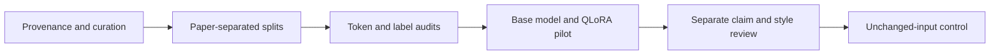

# Meaning-preserving economics rewriting with Gemma and QLoRA

An experimental fine-tuning project: rewrite neutral plain English into the economics prose of Eugene Fama and his coauthors **while preserving the original claims**. This repository contains data-curation tools, training/evaluation code, standalone Kaggle notebooks, CPU tests, and an offline review interface.

**Current finding:** QLoRA reduced validation loss but increased copying. Explicit rhetorical and claim guidance can improve individual controls, but faithful Fama/coauthor-style transformation is **not established**. The project reports these negative and mixed results separately from successful pipeline execution.

**Research checkpoint — 27 October 2026:** In a six-paper external-model comparison,
oracle guidance matched the requested claim grouping in 6/6 cases versus 3/6 for
ordinary rewriting with shared evidence. Incremental expression benefits were
selective; distinctive author-style quality and generalization remain unproven.
These are inspected training examples with user-reported GPT-6 High and uncontrolled
chat context. [Paired findings and limits](docs/PAPER_PLAN_COMPARISON_V1_RESULTS.md).

## What was built

- Corpus curation with provenance, source hashes, recorded selection/repairs, duplicate screening and whole-paper splits.
- Completion-only labels verified against actual chat-template tokens, with no target truncation.
- NF4/FP32 QLoRA on one Kaggle T4, with finite loss/gradient checks and language-attention adapters only.
- Adapter save/reload verification using tensor hashes and matching per-example losses.
- Frozen base-versus-adapter comparisons and a three-way review with **unchanged input as a control**.
- Notebooks generated from Python; CPU checks require neither a GPU nor model downloads. Kaggle execution is manual so Secret access can be verified first.



## Experiment snapshot

The curated corpus has **313 pairs from nine papers**, selected from 13 processed papers: **247 train / 21 validation / 45 test**, separated by paper. Validation uses FF1997 and test uses FF2014. Taxonomies are local metadata, not training targets.

| One-epoch Gemma 3 4B pilot | Result |
|---|---:|
| Training pairs / optimizer updates | 247 / 124 |
| Original validation loss, all 21 pairs | 3.5449 |
| Adapted / reloaded validation loss | 1.1403 / 1.1403 |
| Relative loss decrease | 67.83% |
| Exact input copies, base → adapted | 0/21 → 6/21 |
| Output words, base → adapted | 2,960 → 1,713 |
| Peak allocated GPU memory | 6.79 GiB |

These are development-validation results from one held-out paper, not a fresh multi-paper benchmark. Lower target loss does not establish generated style or semantic fidelity. Unblinded qualitative review found fewer unsupported additions and a remaining table-reference error. Independent numerical claim/style ratings are not available; real-data three-way scores remain blank. [Results and limitations](docs/RESULTS.md).

## Research extension: rhetorical plans and claim preservation

The extension compares direct adaptation with explicit rhetorical planning while
keeping semantic evidence separate from style controls. It includes training-signal
analysis, a three-level schema, LLM annotation/consistency workflows, inference-only
Kaggle experiments and CPU-only analysis of saved generations. A small matched
[direct-versus-planned supervised-realization pilot](docs/PLAN_REALIZER_PILOT_V1_RESULTS.md)
also ran; it did not meet its style follow-up trigger. Further training is deferred.

| Executed investigation | Finding | Scope |
|---|---|---|
| Training-signal analysis | Substantial input/reference wording contrast; copying is not explained by identical training pairs | 247 training pairs |
| Initial rhetorical oracle | Did not pass the predefined generation-improvement gate | 21 development-validation examples |
| Concise target plan | Better count-match rate concealed a six-to-one sentence collapse | Four inspected training pairs |
| Count-only versus sentence slots | Slots partly controlled counts; formatting and claim drift remained | Same four training pairs |
| Claim constraints × paragraph/slots | Paragraph NLI proxy passes rose from 1/4 to 4/4; constrained slots matched counts on 4/4 but passed the joint count/format/NLI proxy on only 2/4 | 16 generations, four training pairs |
| Saved-output claim audit | Flags bound, qualification and possible-addition risks, including warnings in four NLI-passing outputs | Same 16 saved generations; no new model calls |
| Frozen claim-checker benchmark | Detected 5/12 held-out mutations; accepted 0/12 nontrivial faithful paraphrases; readiness gate failed | 72 synthetic controls, 36 per split; CPU only |
| Scoped v3 verifier calibration | Detected 16/16 changed outputs; accepted 14/16 faithful paraphrases; falsely flagged 2/32 faithful outputs; synthetic gate passed | 48 fresh targeted synthetic cases; not domain accuracy |
| Soft rhetorical guidance | No clear overall gain: fewer scope abstentions, worse mean style proxy and more sentence inflation | 42 generations on 21 previously used development examples |
| Ledger/grouping ablation | Exact control replication; sentence-only/no-grouping gave the cleanest style proxy, but semantic screening remained unresolved | Eight generations on two exposed failures |

These small diagnostics do not establish generalization, author-style quality or
semantic accuracy. Rule warnings can be valid paraphrases; no warnings is not a
pass. NLI sanity controls do not establish domain reliability. Source/reference
alignment remains uncertain, and the 45 reserved test examples remain outside
development and model selection.

Start with the [rhetorical representation and research precedents](docs/RHETORICAL_STRUCTURE.md),
[claim-constrained experiment results](docs/CLAIM_CONSTRAINED_REALIZATION_V1_RESULTS.md)
and [saved-output claim audit](docs/CLAIM_LEVEL_AUDIT_V1.md). Earlier stages:
[signal analysis](docs/RESEARCH_EXTENSION.md),
[oracle results](docs/RHETORICAL_ORACLE_V1_RESULTS.md),
[concise-plan results](docs/CONCISE_PLAN_REALIZATION_V1_RESULTS.md) and
[sentence-slot results](docs/SENTENCE_SLOT_REALIZATION_V1_RESULTS.md).
Preparation documents preserve their pre-execution status statements; the linked
results reports record the completed runs.

The [frozen rule-checker benchmark](docs/claim_checker_benchmark_v1/RESULTS.md)
failed, while the revised [scoped NLI verifier](docs/CLAIM_VERIFIER_CALIBRATION_V3_RESULTS.md)
passed its targeted synthetic gate. The completed
[soft-guidance comparison](docs/SOFT_GUIDANCE_VALIDATION_V1_RESULTS.md) did not
establish an overall gain. The completed [ledger/grouping ablation](docs/LEDGER_GROUPING_ABLATION_V1_RESULTS.md)
supports a simpler baseline. The completed [source-sentence-preserving edit test](docs/SENTENCE_PRESERVING_EDIT_V1_RESULTS.md)
improved sentence-length control but did not establish faithful style improvement.
The [graded style/drift reassessment](docs/STYLE_DRIFT_TRADEOFF_V1_RESULTS.md)
now permits minor drift and retains verifier warnings for comparison rather than
automatically excluding outputs. A [24-candidate inference comparison](docs/STYLE_TRADEOFF_CANDIDATES.md)
has [completed results](docs/STYLE_TRADEOFF_CANDIDATES_V1_RESULTS.md): copying was
absent in this sample, but substantial reference-style improvement was not established.
A matched [author-name versus concrete name-free instruction test](docs/NAME_FREE_STYLE_ABLATION.md)
has [completed results](docs/NAME_FREE_STYLE_ABLATION_V1_RESULTS.md): the concrete
prompt improved length control, while material drift and limited reference-style
improvement remained.
An [audit of the actual taxonomy training signal](docs/TAXONOMY_TRAINING_SIGNAL_V1_RESULTS.md)
finds 35 paired LLM-annotated training examples, substantial same-text annotation
variation, and three source-bound grouping hypotheses for follow-up.
A [27-generation grouping-realization diagnostic](docs/BOUND_GROUPING_REALIZATION.md)
has [completed results](docs/BOUND_GROUPING_REALIZATION_V1_RESULTS.md): the oracle
arm matched requested counts in 2/9 outputs, with partial grouping success but
no substantial reference-style improvement established.
A [groupwise realization and assembly comparison](docs/GROUPWISE_REALIZATION.md)
[stopped on a token cutoff](docs/GROUPWISE_REALIZATION_V1_FAILURE.md) after its
group prompts elicited whole-argument responses. A separate
[v2 run](docs/GROUPWISE_REALIZATION_V2_RESULTS.md) achieved valid one-sentence
pieces and 9/9 requested assembly counts, while introducing major content drift.
Source-grounded group realization remains unresolved.
Further QLoRA
or structural-mapper training is deferred. Public files contain code, schemas,
synthetic examples and aggregate reports; annotation responses, full paragraphs,
raw generations and model artifacts remain private.

## Local checks

Python 3.9+ is sufficient. An optional browser-behavior test uses Node when available.

```sh
python3 -m unittest discover -s tests -v
python3 train.py --check
python3 scripts/build_notebooks.py
```

The default dry-run uses **three synthetic educational examples**. It accesses no Secret, downloads no weights and starts no training. Tests requiring private corpus/results explicitly skip when those files are absent; synthetic CPU tests remain active. [Reproduction guide](docs/REPRODUCIBILITY.md).

The original CLI retains `google/gemma-3-1b-it`. Later corpus experiments explicitly use `google/gemma-3-4b-it`. ML imports occur only in runtime functions. [Data availability](data/README.md).

## Kaggle workflow

1. [Base/token audit](kaggle/corpus_v1_baseline.ipynb): 313 token audits and 21 base validation generations.
2. [Five-step smoke](kaggle/corpus_v1_smoke.ipynb): three training examples, five updates and adapter reload checks.
3. [One-epoch pilot](kaggle/corpus_v1_pilot.ipynb): one pass over 247 pairs and full validation comparison.

Import through Kaggle's UI, attach the specified private inputs, select **GPU T4 x2** (only its first GPU is used), enable internet and the `HF_TOKEN` Kaggle Secret, then Save & Run All. Never paste credentials into code or tracked files. The notebooks pin recorded inputs; they are not generic launchers for arbitrary data. [Notebook guide](kaggle/README.md).

Recorded runs: [baseline version 4](https://www.kaggle.com/code/oliverlds/corpus-v1-baseline), [smoke version 1](https://www.kaggle.com/code/oliverlds/corpus-v1-smoke), [pilot version 1](https://www.kaggle.com/code/oliverlds/corpus-v1-pilot). These links may require owner-granted access; GitHub publication does not change Kaggle visibility.

## Repository map

| Path | Contents |
|---|---|
| `src/fama_style/` | Training, evaluation, diagnostics and prompts |
| `scripts/` | Curation, notebook generation and publication checks |
| `kaggle/` | Notebooks with saved cell outputs cleared |
| `tests/` | Synthetic CPU checks and optional private-artifact checks |
| `data/` | Documentation, frozen instruction and synthetic examples |
| `docs/` | Results, reproducibility and publication policy |

Source PDFs, full-text datasets, generated review packets, raw outputs, checkpoints, tokenizers and credentials are **not distributed here**. The full local workspace retains them outside Git tracking. [Public file-selection policy](docs/PUBLICATION.md). The MIT license covers project code and original documentation, not third-party papers or Gemma assets.

[Read-only source-context restoration v1 results](docs/GROUP_CONTEXT_RESTORATION_V1_RESULTS.md): all 18 calls completed, all nine local controls reproduced, and context resolved the six ambiguous-group subjects. Imported claims and numeric/relation errors remained; no substantial author-style improvement was established. No further GPU job has been submitted.

[Minimal antecedent expansion v1 results](docs/MINIMAL_ANTECEDENT_V1_RESULTS.md): all 27 calls completed and all 18 controls reproduced. Explicit actors retained the economic topic but quantity-role errors and invented mechanisms persisted, without substantial author-style gain. The [matched supervised-realization pilot v1](docs/PLAN_REALIZER_PILOT_V1_RESULTS.md) completed: both adapters trained/reloaded and all 36 generations finished. On four development examples the planned adapter had fewer assessed serious errors but more source copying, without substantial author-style gain; the style follow-up trigger was not met. No additional training was submitted.

Prepared [reference-grounded rhetorical operations](docs/GROUNDED_RHETORICAL_OPERATIONS.md): four claim-bound transformation hypotheses plus one preservation control from training annotations, with source-only prompt previews, seven numeric-role bindings, a closed program schema and CPU replay checks. These are fixed-case oracle programs, not a learned mapper or new model results; no GPU job was submitted.

[Grounded-operation realization results](docs/OPERATION_REALIZATION_RESULTS.md): all 30 calls completed with the verified saved adapter. Richer guidance improved preservation on the four transformation examples but produced no substantial style gain; the adapter copied the source closely in three cases, and the separate preservation control exposed incorrect citation/explanation binding. No mapper training or new GPU run was initiated.

[External-realizer response results](docs/STRONG_REALIZER_CHECK_RESULTS.md): all ten responses imported; the user reports GPT-6 for both batches. Richer programs produced incremental reference-grounded structural/style gains in three of four transformation cases and preserved citation bindings in the control, with one minor strength change. This is a provisional actionability signal on reused oracle cases, not proof of author specificity or generalization; no new training was started.

[Operation-expansion response audit](docs/OPERATION_EXPANSION_RESULTS.md): all 30 records received; 28 original contracts passed and two local programs were recovered as explicit excerpts. Only three exact whole-paragraph seeds plus one exact excerpt are available, so training remains gated. Sixteen of the 24 already-structured labels still show packing/order changes, motivating a broader elementary-edit catalogue using the existing annotations. No GPU run was started.

[Elementary packing edits](docs/ELEMENTARY_PACKING_EDITS.md): a separate CPU compiler derives ten oracle merge/split candidates across six papers, including one reserved diagnostic probe. Six ambiguous repeated-claim cases remain blocked. These are untested realization candidates; original training gates remain unchanged.

[Elementary packing realization results](docs/ELEMENTARY_PACKING_REALIZATION_V1_RESULTS.md): all 12 calls completed. The five new candidates showed no complete organization matches or demonstrated substantial incremental style gains; the reserved probe matched sentence counts but reversed a comparison. Numeric-offset claim bindings remain a prompt-format confound. Test readable source bindings before further training.

[Readable packing format results](docs/READABLE_PACKING_ABLATION_V1_RESULTS.md): all four calls completed, and historical controls reproduced exactly. Readable guidance improved sentence-count matches from 0/2 to 2/2, but both claim-bound plans remain unrealized. Hierarchy concision improved modestly; the finding/presumption split still corrupts attribution. Next compare the same frozen prompts with a stronger realizer before training.

[External readable-packing results](docs/READABLE_STRONG_REALIZER_V1_RESULTS.md): all four returned responses realize the intended claim-bound merge/split in the exploratory audit, with two limited force-shift caveats. Both formats work; distinctive author style and a benefit over ordinary rewriting remain unproven. Next compare ordinary/shared-evidence rewriting against readable plans across six papers before training. The user reports GPT-6 High thinking effort in one shared chat; cross-job/condition carryover limits independent comparison.

[Six-paper ordinary-versus-plan results](docs/PAPER_PLAN_COMPARISON_V1_RESULTS.md): 12/12 responses imported unchanged. Guidance matches all six claim-group programs; ordinary/shared-evidence rewriting already matches three. Of four paper extensions, one has a clear incremental organization gain, one is borderline due to density and two add little. No substantive drift was identified in the exploratory audit. Plans remain optional structural control; author-style superiority and training readiness are unproven. User reports GPT-6 High; prior-chat context is uncontrolled.


