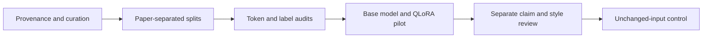

# Meaning-preserving economics rewriting with Gemma and QLoRA

An experimental fine-tuning project: rewrite neutral plain English into the economics prose of Eugene Fama and his coauthors **while preserving the original claims**. This repository contains data-curation tools, training/evaluation code, standalone Kaggle notebooks, CPU tests, and an offline review interface.

**Current finding:** a one-epoch Gemma 3 4B QLoRA pilot substantially reduced validation loss and verbose elaboration, but increased input copying. Distinctive Fama-style improvement is **not established**. Claim preservation and style are evaluated separately.

## What was built

- Corpus curation with provenance, source hashes, recorded selection/repairs, duplicate screening and whole-paper splits.
- Completion-only labels verified against actual chat-template tokens, with no target truncation.
- NF4/FP32 QLoRA on one Kaggle T4, with finite loss/gradient checks and language-attention adapters only.
- Adapter save/reload verification using tensor hashes and matching per-example losses.
- Frozen base-versus-adapter comparisons and a three-way review with **unchanged input as a control**.
- Notebooks generated from Python; CPU checks require neither a GPU nor model downloads. Kaggle execution is manual so Secret access can be verified first.



## Experiment snapshot

The curated corpus has **313 pairs from nine papers**, selected from 13 processed papers: **247 train / 21 validation / 45 test**, separated by paper. Validation uses FF1997 and test uses FF2014. Taxonomies are local metadata, not training targets.

| One-epoch Gemma 3 4B pilot | Result |
|---|---:|
| Training pairs / optimizer updates | 247 / 124 |
| Original validation loss, all 21 pairs | 3.5449 |
| Adapted / reloaded validation loss | 1.1403 / 1.1403 |
| Relative loss decrease | 67.83% |
| Exact input copies, base → adapted | 0/21 → 6/21 |
| Output words, base → adapted | 2,960 → 1,713 |
| Peak allocated GPU memory | 6.79 GiB |

These are development-validation results from one held-out paper, not a fresh multi-paper benchmark. Lower target loss does not establish generated style or semantic fidelity. Unblinded qualitative review found fewer unsupported additions and a remaining table-reference error. Independent numerical claim/style ratings are not available; real-data three-way scores remain blank. [Results and limitations](docs/RESULTS.md).

## Local checks

Python 3.9+ is sufficient. An optional browser-behavior test uses Node when available.

```sh
python3 -m unittest discover -s tests -v
python3 train.py --check
python3 scripts/build_notebooks.py
```

The default dry-run uses **three synthetic educational examples**. It accesses no Secret, downloads no weights and starts no training. Tests requiring private corpus/results explicitly skip when those files are absent; synthetic CPU tests remain active. [Reproduction guide](docs/REPRODUCIBILITY.md).

The original CLI retains `google/gemma-3-1b-it`. Later corpus experiments explicitly use `google/gemma-3-4b-it`. ML imports occur only in runtime functions. [Data availability](data/README.md).

## Kaggle workflow

1. [Base/token audit](kaggle/corpus_v1_baseline.ipynb): 313 token audits and 21 base validation generations.
2. [Five-step smoke](kaggle/corpus_v1_smoke.ipynb): three training examples, five updates and adapter reload checks.
3. [One-epoch pilot](kaggle/corpus_v1_pilot.ipynb): one pass over 247 pairs and full validation comparison.

Import through Kaggle's UI, attach the specified private inputs, select **GPU T4 x2** (only its first GPU is used), enable internet and the `HF_TOKEN` Kaggle Secret, then Save & Run All. Never paste credentials into code or tracked files. The notebooks pin recorded inputs; they are not generic launchers for arbitrary data. [Notebook guide](kaggle/README.md).

Recorded runs: [baseline version 4](https://www.kaggle.com/code/oliverlds/corpus-v1-baseline), [smoke version 1](https://www.kaggle.com/code/oliverlds/corpus-v1-smoke), [pilot version 1](https://www.kaggle.com/code/oliverlds/corpus-v1-pilot). These links may require owner-granted access; GitHub publication does not change Kaggle visibility.

## Repository map

| Path | Contents |
|---|---|
| `src/fama_style/` | Training, evaluation, diagnostics and prompts |
| `scripts/` | Curation, notebook generation and publication checks |
| `kaggle/` | Notebooks with saved cell outputs cleared |
| `tests/` | Synthetic CPU checks and optional private-artifact checks |
| `data/` | Documentation, frozen instruction and synthetic examples |
| `docs/` | Results, reproducibility and publication policy |

Source PDFs, full-text datasets, generated review packets, raw outputs, checkpoints, tokenizers and credentials are **not distributed here**. The full local workspace retains them outside Git tracking. [Public file-selection policy](docs/PUBLICATION.md). The MIT license covers project code and original documentation, not third-party papers or Gemma assets.
